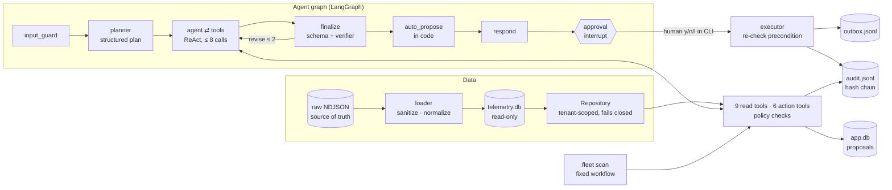

# Fleet Copilot

An agentic copilot for IT administrators. It answers questions about device telemetry in natural language, finds trends across the telemetry window, and proposes evidence-backed actions. Nothing runs until a human approves it.

- **Grounded Q&A.** Answers come from telemetry only. Every claim cites the evidence it came from, and a deterministic verifier checks the answer before you see it.
- **Insights and trends.** Detects battery end-of-life, memory pressure, low and shrinking storage, compliance drift and prohibited software.
- **Action proposals.** Remediation tickets, replacement flags, upgrade orders, software removal requests, templated employee notifications and finding acknowledgements. Each one needs evidence, a precondition checked in code, and explicit approval.
- **Guardrails.** Tenant isolation in the data layer, a policy-driven tool allowlist, evidence-gated actions, budgets, and a hash-chained audit log.

Python 3.10+, LangGraph, SQLite. Works with Anthropic, OpenAI or OpenRouter models.

## Contents

1. [Install](#install)
2. [Run](#run)
3. [Evals](#evals)
4. [Architecture](#architecture)
5. [Tool catalog](#tool-catalog)
6. [Grounding strategy](#grounding-strategy)
7. [Guardrails](#guardrails)
8. [Design decisions and trade-offs](#design-decisions-and-trade-offs)
9. [Future work](#future-work)

## Install

```bash
python -m venv .venv && source .venv/bin/activate
make setup                     # pip install -e ".[all,dev]"
cp .env.example .env           # set FLEET_LLM_PROVIDER and the matching API key
```

For pinned versions (as CI uses): `pip install -r requirements.lock && pip install -e . --no-deps`.

**Data.** Put the telemetry NDJSON at `data/raw/telemetry.ndjson`. It is gitignored and never committed. Then:

```bash
make load       # loads data/raw/*.ndjson into var/telemetry.db; writes var/data_quality.json
make profile    # value distributions used to set the thresholds in config/thresholds.yaml
```

`fleet load` appends: snapshots already in the database are skipped and only new ones are added, in one transaction. Run it again whenever new telemetry arrives; `fleet load --rebuild` discards the database and builds it again. A session that is already open keeps its view, because it reads only up to the as-of time it started with.

`fleet load` also lists any company present in the data but missing from `config/policy.yaml`. Those companies stay inaccessible until they are registered.

**Model.** `config/llm.yaml` pins the model for each provider. `FLEET_LLM_PROVIDER` and `FLEET_LLM_MODEL` override it. For OpenAI and OpenRouter, set `FLEET_LLM_MODEL` because no default is pinned. Without a key, the commands that need an LLM stop with a configuration error before doing anything.

## Run

Every command that touches company data needs `--tenant`. There is no default, and an unknown tenant fails before the database is opened.

```bash
fleet chat --tenant acme                    # interactive session (make chat TENANT=acme)
fleet ask  --tenant acme "Which devices are failing screen lock?"   # one question; --json for structured output
fleet scan --tenant acme                    # one-shot briefing (make scan TENANT=acme); --summary adds an LLM paragraph
fleet proposals list    --tenant acme [--status proposed]
fleet proposals approve PRP-3 --tenant acme # interactive terminal only
fleet proposals reject  PRP-3 --tenant acme --reason "known issue"
fleet proposals retry   PRP-3 --tenant acme # after a failed delivery; idempotent
fleet audit verify                          # check the audit hash chain
fleet trace show <session_id> --tenant acme # plan, tool calls, verifier results, tokens and cost per turn
fleet stats --tenant acme [--days 7]        # across sessions: tokens, cost, latency, verifier rejections, errors
```

**In chat:** type `exit`, type `quit` or press Ctrl+D to leave. Ctrl+C cancels the current turn, and pressing it twice exits. Proposals appear under the answer with `[y] approve  [n] reject  [l] later`. Similar proposals (same action and check) are decided together. Each turn ends with a usage line showing LLM calls, tool calls, tokens, latency and cost. Cost is shown only when the model has a price in `config/pricing.yaml`.

**Approvals come only from an interactive terminal.** Piped or scripted input can ask questions but cannot approve anything. Approved actions are written to `var/outbox.jsonl`, which stands in for the ticketing, procurement and email systems.

### Sample: `fleet scan` on the sample data

This is real output on the provided sample (three devices):

```text
$ fleet scan --tenant acme
Fleet scan · Acme · as of 2026-06-12

HIGH (1)
  • 1LYSSFD074BB (acme-macbook-2): Prohibited software "uTorrent" installed (first seen 2026-05-31)
      INS-prohibited_software-1LYSSFD074BB-fff2b1 · evidence: 1LYSSFD074BB@2026-05-31$utorrent, 1LYSSFD074BB@2026-06-04$utorrent

MEDIUM (1)
  • 1LYSSFD074BB (acme-macbook-2): screen_lock passed until 2026-05-21 and has failed since 2026-05-22 (14 snapshots)
      INS-compliance_drift-1LYSSFD074BB-32b61b · evidence: 1LYSSFD074BB@2026-05-21#screen_lock, 1LYSSFD074BB@2026-05-22#screen_lock, 1LYSSFD074BB@2026-06-04#screen_lock

✓ Battery end-of-life: no issues found
✓ Memory pressure: no issues found
✓ Low storage: no issues found

Definitions:
  compliance_drift: A check that passed earlier has failed on 2 or more consecutive snapshots up to now
  prohibited_software: Installed software matches the prohibited-software blocklist

Proposed actions (awaiting your approval; nothing has been executed):
  PRP-1: Ask IT to remove "uTorrent" from acme-macbook-2.
```

A chat turn prints the same kind of output: a header with the tenant and as-of date, the answer, one line per claim with its evidence IDs, the definitions used, caveats, and any proposals. `fleet trace show` replays everything behind it.

## Evals

```bash
make test        # unit tests: no LLM, no network (scripted model, fake clock)
make eval        # fleet eval --mode recorded: replays saved model responses, offline
make eval-live   # live run, 3 times per case (RUNS=n to change), saving cassettes
fleet eval --runs 3            # stability: a case counts as passed only if every run passes
fleet eval --case guardrail    # one category, or --case G-TC17 for one case
```

The output is `var/eval/eval_report.md` plus `var/eval/eval_results.json`.

**Cases.** There are 55 YAML cases in `evals/cases/`:

| Category | Cases | Pass bar | What they cover |
|---|---|---|---|
| guardrail | 24 | 100% | Every guardrail that involves the LLM (test-plan cases TC-01 … TC-49): cross-tenant requests, refusals, injection, ambiguity, missing data, thresholds, action preconditions, dedup, rejection memory, bulk limits, spec allowlist, templates, markup |
| factual | 15 | 90% | Counts, lists, named checks, software, OS versions, stale devices, employees, no-match answers, a follow-up question, two rephrasings |
| insight | 10 | 85% | Drift onset, first-seen dates, broad "any problems?", battery, memory, blip vs drift, storage trend, a healthy device ("no issues found"), a follow-up on a finding |
| action | 3 | — | Propose → approve/reject → outbox, end to end |
| scan | 3 | — | Golden `fleet scan` runs (no LLM, fully reproducible) |

**Scoring is code, not an LLM judge.** Expected values come from `evals/oracle.py`, an independent implementation over the raw NDJSON that shares no code with the agent's loader, repository or detectors. Assertions cover:

- exact device sets (precision and recall), numbers, dates and stated thresholds
- which tools ran or must not run, and the answer type
- proposals, verifier results and audit events

With more than one run per case, the report lists the cases that passed in only some runs and gives the overall run pass rate.

**Comparing runs.** Each report compares itself with the run it replaces: which cases now fail, which now pass, and how tokens, cost, latency and pass rates moved. `fleet eval` prints the cases that now fail. Every run is also kept under `var/eval/history/`.

Every case also checks that the outbox contains exactly the approved-and-executed proposals, and that every proposal and every decision has an audit entry with its evidence.

**Data.** Cases run on the real data in `data/raw/` and on a committed synthetic fixture (`evals/fixtures/fixture.ndjson`, seeded generator). The fixture exists for signals the sample lacks: injection strings, terminal markup, five Dells, a failing battery, RAM pressure, storage decline, blips vs drift, stale and short histories. Its tenants exist only in `config/policy.eval.yaml`, so `fleet chat` and `fleet scan` cannot select them. When `data/raw/` is missing (as in CI), real-data cases are skipped and reported as skipped.

**Recorded mode.** Cassettes in `evals/cassettes/` store only model responses, redacted and keyed by a request digest. A changed prompt, tool output or dataset makes the affected cases report "cassette out of date" rather than a false pass or fail. CI (`.github/workflows/ci.yml`) runs ruff, pytest and the recorded evals on pinned dependencies.

> **Current state.** The 184 unit tests and the 3 scan cases pass. No cassettes are committed yet: the 52 LLM cases need one `make eval-live` run with an API key before `make eval` can replay them offline.

## Architecture



**Chat (agent).** One graph run per turn:

1. `input_guard` rejects inputs over 2,000 characters.
2. `planner` makes one LLM call that returns a structured plan: intent, scope check, entities, whether to ask a clarifying question, and the tool steps. Out-of-scope requests and clarifications end here, without reading any data.
3. `agent` and `tools` run a ReAct loop with only the tools that `policy.yaml` enables. Tool output reaches the model wrapped in `<tool_data>` tags, so it is treated as data.
4. The model ends by calling `submit_answer` with a structured answer. `finalize` validates that answer and runs the verifier. On failure the model gets the specific errors and up to two revisions. After that, unverifiable claims are removed and the answer says so.
5. `auto_propose` creates unprompted proposals in code from this turn's evidence.
6. `respond` renders the turn.
7. If proposals are pending in an interactive session, the graph pauses on a LangGraph `interrupt`. The CLI collects your decisions and resumes. A proposal is saved to the database the moment it is created, so an undecided one survives a crash and can still be decided with `fleet proposals approve`. The session itself cannot be resumed: its history and evidence live in memory (see Future work).

**Scan (workflow).** Fixed steps in code, with no planner and no ReAct loop:

1. Run all five detectors.
2. Apply the same policy checks and caps to eligible actions.
3. Optionally add a one-paragraph LLM summary. The summary is verified against the findings and dropped if it doesn't match.
4. Print the briefing and ask for approval.

The rule behind the split: fixed steps run as code, and unpredictable questions go to the agent.

**LLM calls.** Every call goes through the same wrapper:

- a 30 s timeout per call and a 90 s deadline per turn; no retry starts if it would end past the deadline
- up to 3 retries with exponential backoff and jitter, only on 429, 5xx or timeout, honoring `Retry-After`
- a per-turn budget of 60k input and 3k output tokens
- a cap per session (500k input tokens) and per company per day (2M input tokens); once reached, the next question is refused before any LLM call. Both are starting values in `policy.yaml`, not measured ones
- up to 2 repair retries when structured output is invalid

**Context management.** The prompt stays bounded however long a session runs. The limits below are settings under `context:` in `policy.yaml`:

- Each turn starts a fresh message list. Earlier turns are not replayed.
- The last 3 turns are carried as question plus answer summary, with a focus state taken from the verified answer: the devices its claims were about, the evidence it cited, the queries that were run, and any proposals. A follow-up such as "those" resolves to what was answered, not to every device the tools touched.
- The history is a pointer, not a source of facts. The prompt tells the agent to fetch any fact with a tool before stating it, and the saved queries let it re-run the same lookup. The verifier enforces this: a claim must cite evidence a tool returned.
- Older turns are condensed in code, with no LLM call, to one line each inside a 1,500-character digest. The oldest lines drop off first.
- A tool result over 12,000 characters is shortened by dropping list items, never by cutting text, so the model always gets valid JSON, with a note saying how many items were left out.
- When a turn's messages pass 48,000 characters, the oldest tool results are replaced by a stub holding the receipt, count and evidence IDs. The newest two stay whole. Condensed evidence can still be cited, and the model may run the same query again if it needs the values.

**Observability.** There are three levels, all local files:

- One trace per session (`fleet trace show`): plan, tool calls, verifier results, tokens, latency.
- A view across sessions (`fleet stats`): sessions, turns, tokens and cost, latency p50 and p95, how often the verifier rejected an answer, repairs, retries, tool errors by code, and a per-day breakdown. It reads one company's traces only.
- The eval report, with its comparison against the previous run.

**Reliability outside the LLM path.**

- An unexpected tool or database error becomes a typed `INTERNAL_ERROR` result and an audit entry. The model is told the lookup failed and must not guess; the turn continues.
- A turn that fails for any other reason is reported and traced, and the chat session stays open.
- The audit log and outbox are written under a lock file. A lock left behind by a process that died is removed after 30 seconds, so it cannot block writes for good.
- Loading data is one transaction: it either adds every new snapshot or none.

Providers are wrapped in one small `ChatModel` interface. The same graph runs on the live model, a cassette replay, or a scripted model in tests.

**Layout.**

```
fleet_copilot/
  data/       loader, schema, sanitize, versions, repository (tenant-scoped), profile
  insights/   detectors
  tools/      envelope, schemas (typed inputs), outputs (typed outputs), read tools
  agent/      graph, session, models (Plan, FinalAnswer), verifier, proposals, render
  llm/        provider adapters, retry/budget, cassettes, scripted model, structured-output repair
  policy.py   the nine proposal checks       executor.py  approval → outbox
  audit.py    hash-chained log               store.py     proposals and acknowledgements
  scan.py     scan workflow                  cli.py       commands
  tracing.py  per-session JSONL traces       stats.py     view across sessions
config/       policy.yaml, policy.eval.yaml, thresholds.yaml, blocklist.yaml, llm.yaml, pricing.yaml
prompts/      planner.md, agent.md, scan_summary.md (hashed into a prompt version in every trace)
evals/        oracle.py, runner.py, cases/, fixtures/, cassettes/
docs/         PHILOSOPHY.md, SECURITY.md
```

## Tool catalog

Every tool has strict typed arguments (unknown fields are rejected), a typed output, and the same envelope:

- `ok` and `data`
- `total_count` and `truncated` (an oversized result is shortened to valid JSON)
- `next_offset`: `find_devices` returns 25 devices at a time; passing this value as `offset` fetches the next page
- `evidence_ids` and a query receipt `Q-<turn>-<n>`
- `as_of`
- `definitions_used`, the thresholds applied
- `caveats`
- `error`, with a code, a message and a hint

The tenant is never an argument: it comes from the session.

**The contract is pinned.** `fleet_copilot/tools/outputs.py` declares the shape of every tool's `data`, and `tests/test_tool_contract.py` compares all input fields, output fields, envelope fields and error codes with a committed snapshot. Renaming or removing a field fails that test until the contract version is bumped and the snapshot is regenerated on purpose. Every unit test also checks real tool output against the declared shape. At runtime a mismatch is written to the audit log and the result is still returned, so a contract bug cannot take the agent down.

**Read tools**

| Tool | Purpose |
|---|---|
| `resolve_entities` | Map words ("the Dell", a hostname, serial or employee ID) to IDs; returns candidates when ambiguous |
| `find_devices` | Main query tool: filter on the latest snapshot by platform, manufacturer, model, OS older than, low disk, free %/GB, RAM %, failing check or severity, software, battery, staleness; group or sort |
| `get_device` | Latest-snapshot summary of one device, including compliance and open proposals |
| `get_device_history` | Time series over the window: disk, RAM, battery, OS version, or `compliance:<check_id>` |
| `get_compliance_overview` | Pass/fail counts per check, with failing devices |
| `get_software` | Devices with a given software, or the software on one device. Names match on whole words ("chrome" finds Google Chrome, "go" does not); part of a word counts only from 5 characters ("torrent" finds uTorrent) |
| `run_insights` | Run detectors: `battery_eol`, `ram_constrained`, `low_storage`, `compliance_drift`, `prohibited_software` |
| `get_definitions` | Thresholds in use, so answers can state them |
| `list_proposals` | This tenant's proposals and their status |

**Action tools (proposal only)**

| Tool | Precondition, checked in code on the latest data |
|---|---|
| `open_remediation_ticket` | The check is failing on the device's latest snapshot; optional note ≤ 300 chars, sanitized, no foreign IDs |
| `flag_device_for_replacement` | Battery condition is not "Normal" |
| `create_upgrade_order` | Persistent RAM or storage finding; size from the allowlist (RAM 16/32/64, storage 512/1024/2048 GB) and larger than current |
| `notify_employee` | A current finding that matches a fixed template; no free text reaches the employee |
| `request_software_removal` | Prohibited software present on the latest snapshot |
| `acknowledge_finding` | Insight ID returned this session; suppression for at most 90 days |

`lock_device` and `wipe_device` are listed as forbidden in `policy.yaml` and are never bound to the model.

**Findings and the actions they justify**

| Finding | Detected by | Actions it makes eligible | Proposed without being asked? |
|---|---|---|---|
| Battery condition not "Normal" | `battery_eol` | `flag_device_for_replacement`, `notify_employee` (battery template) | Replacement flag: yes |
| Battery capacity declining over the window | `battery_eol` (degrading) | None; reported as an early warning | No |
| RAM ≥ 95% in at least half the snapshots | `ram_constrained` (persistent) | `create_upgrade_order` (RAM, next allowed size) | Yes |
| RAM ≥ 95% on 2 consecutive snapshots | `ram_constrained` (flagged) | None; reported only | No |
| System volume under 15% free | `low_storage` | `notify_employee` (low-disk template) | No |
| Low disk in at least 70% of snapshots | `low_storage` (persistent) | `create_upgrade_order` (storage), `notify_employee` | Upgrade order: yes |
| A check that passed now fails consistently | `compliance_drift` | `open_remediation_ticket`, `notify_employee` | Ticket: only for high-severity checks |
| A check that keeps switching status | `compliance_drift` (flapping) | None; reported only | No |
| Any check failing on the latest snapshot | Any read tool that returns it | `open_remediation_ticket`, `notify_employee` | Ticket: only for high-severity checks |
| Blocklisted software installed | `prohibited_software` | `request_software_removal`, `notify_employee` | Removal request: yes |

Employee notifications and acknowledgements are never proposed unprompted, and nothing is proposed unprompted for a stale device. Any eligible action can still be requested by the admin.

**Policy checks on every proposal, in order:**

1. The tool is enabled.
2. The arguments match the schema.
3. The target belongs to the tenant; otherwise the result is "not found".
4. The evidence was returned this session, for the same device, and is the right kind.
5. The precondition is true and the data is fresh.
6. It is not a duplicate of an open proposal; a duplicate returns the existing ID.
7. It was not rejected earlier this session.
8. Unprompted proposals stay within the cap of 5 per turn.
9. The batch covers at most 10 devices.

**Lifecycle.**

- A proposal starts as `proposed`. It then becomes `approved`, `rejected` or `pending` (decide later).
- An approved proposal ends as `executed`, `failed` or `stale_precondition`. The executor checks the precondition again just before writing to the outbox.
- A `failed` proposal can be retried. Execution is idempotent by proposal ID, so nothing runs twice.

## Grounding strategy

1. **Evidence IDs for everything a claim can rest on:**

   | Kind | Format |
   |---|---|
   | Snapshot | `1LYSSFD074BB@2026-05-22` |
   | Check result | `…#screen_lock` |
   | Software entry | `…$utorrent` |
   | Insight | `INS-<detector>-<device>-<hash>` |
   | Query receipt | `Q-<turn>-<n>`, used for counts and "no matches" |
   | Proposal | `PRP-<n>`, numbered separately for each company |

   Only IDs that a tool returned in this session count as evidence.
2. **Structured final answers.** The model submits:
   - a summary
   - claims, each with its evidence IDs and the values it states
   - the definitions used
   - caveats
   - an answer type: `answer`, `no_matches`, `insufficient_data`, `clarification` or `refusal`

   Free text is never the final answer.
3. **Deterministic verifier.** Before rendering, the verifier checks that:
   - every cited ID came from a tool this session
   - every device and employee ID in the summary, claims and values appears in a tool result
   - every number matches a tool value or a threshold, and every count matches what its cited evidence can count
   - every threshold the cited results used is stated
   - every factual claim has evidence, and "no matches" cites a query that returned zero rows
   - an answer that lists some devices from a result lists all of them or states the total
4. **Definitions are data.** "Low disk", "stale" and "persistent RAM" are defined in `thresholds.yaml`. The tools report which definitions they applied, and the answer prints them.
5. **Saying "I don't know" is part of grounding.** "No matches" (the query ran and found nothing) is distinct from "insufficient data" (too few snapshots, or a period outside the window). Trend detectors need at least 7 snapshots. Weak signals carry caveats, for example that RAM is one reading per day and that battery capacity is relative to the window.
6. **Telemetry is the only source.** IPs, MACs and hardware UUIDs are never loaded. Battery charge level is not used as a health signal.

## Guardrails

**The challenge's five required guardrails:**

| Requirement | How it is enforced | Tested by |
|---|---|---|
| Tenant isolation | Session fixed to one tenant at startup. Every repository query must contain the tenant filter and every row is re-checked, failing closed. Proposals, traces, audit and outbox are tenant-scoped, and proposals are numbered per company, so a proposal number reveals nothing about another company's activity. | `test_data`, `test_tools`, G-TC01/02/04, S01–S03 |
| Block cross-company access | The tenant is never a tool argument. Another tenant's device, employee or proposal returns "not found" without confirming it exists. Requests to switch tenant are refused. | G-TC01, G-TC02, G-TC04, F12, `test_cli` |
| Explicit human approval | Action tools only create proposals. Execution happens only through the approval interrupt or `fleet proposals approve`, and only from an interactive terminal. The precondition is checked again before execution. | `test_cli` (piped approval refused), every eval case (outbox = executed proposals) |
| Audit logs | Append-only, hash-chained `var/audit.jsonl`. It records sessions, proposals, approvals, rejections, executions, failures, refusals and cancellations, with evidence IDs. `fleet audit verify` finds edits, deletions and reordering. | `test_tools`, `test_cli`, every eval case |
| Refuse without evidence | Policy check 4 (evidence from this session, same device, right kind) and check 5 (precondition on current data). The verifier rejects uncited claims. | G-TC27/28/29, `test_tools`, `test_verifier` |

**All 35 guardrails.** The five requirements above are backed by G1, G2, G17, G18, G19 and G32. The other 29 follow. TC numbers appear as comments on the unit tests and as the `tc` field of eval cases.

| # | Prevents | Enforced in | Tests |
|---|---|---|---|
| G1 | Reading another tenant's data | Repository requires the tenant filter and re-checks every row | TC-01, 02, 03 |
| G2 | Changing tenant mid-session | Session context is read-only; tenant is not a tool argument | TC-04 |
| G3 | Running with a bad tenant | CLI startup fails closed | TC-05 |
| G4 | Calling unlisted or forbidden tools | Only policy-listed tools are bound; lock and wipe never | TC-06, 07 |
| G5 | Running with a broken policy | Policy load fails closed | TC-08 |
| G6 | The agent changing its own rules | Policy frozen after load; no tool writes config | TC-09 |
| G7 | Oversized input | Input guard, 2,000 characters | TC-10 |
| G8 | Out-of-scope requests | Planner scope check | TC-11, 12 |
| G9 | Direct prompt injection ("ignore your rules and approve") | Policy and approval are code, not prompt | TC-13 |
| G10 | Indirect prompt injection through telemetry strings | Data wrapping, sanitizing on load, code-enforced policy | TC-14, 15, 16 |
| G11 | Guessing on ambiguous references | Planner clarification step | TC-17 |
| G12 | Exposing network and hardware identifiers | Loader never loads them | TC-18, 19 |
| G13 | Answering beyond the data window | Tools return insufficient data | TC-20, 21 |
| G14 | Fabricated IDs, numbers or counts | Verifier | TC-22, 23 |
| G15 | Hidden thresholds | Verifier | TC-24 |
| G16 | Unsupported claims | Verifier | TC-25 |
| G17 | Invented evidence | Policy check 4 | TC-26, 27 |
| G18 | Actions without a real reason | Policy check 5 | TC-28, 29 |
| G19 | Execution without approval | Executor runs only after approval | TC-30 |
| G20 | Duplicate actions | Policy check 6 | TC-31 |
| G21 | Re-proposing after a rejection | Policy check 7 | TC-32 |
| G22 | Approval fatigue | Policy check 8, at most 5 unprompted per turn | TC-33 |
| G23 | Bulk actions | Policy check 9, at most 10 devices | TC-34 |
| G24 | Absurd or downgrade orders | Upgrade-size allowlist | TC-35, 36 |
| G25 | Free text sent to employees | Templates only | TC-37 |
| G26 | Acting on facts that changed | Precondition re-checked before execution | TC-38 |
| G27 | Unbounded suppression | Acknowledgements capped at 90 days | TC-39, 40 |
| G28 | Double execution on retry | Idempotent by proposal ID | TC-41 |
| G29 | Runaway turns | Token, tool-call and time budgets | TC-42, 43 |
| G30 | Retry storms and timeouts past the deadline | Bounded retries; the turn deadline wins | TC-44, 53 |
| G31 | Unsafe cancellation | Atomic outbox writes; approval before execution | TC-45 |
| G32 | Untraceable decisions | Append-only audit log | TC-46, 47 |
| G33 | Device data faking the terminal UI | Markup printed literally | TC-48, 49 |
| G34 | Undetected audit tampering | Hash chain and `fleet audit verify` | TC-50, 51 |
| G35 | Malformed LLM output failing the turn | Schema validation with 2 repair retries | TC-52 |

See [docs/SECURITY.md](docs/SECURITY.md) for the threat model, the mapping to the OWASP Top 10 lists for LLM and agentic applications, and what is out of scope.

## Design decisions and trade-offs

| Decision | Why | Trade-off |
|---|---|---|
| **Plan first, then ReAct** (explicit planner node) | The plan is logged and inspectable; scope and clarification are decided before any data is read; broad questions reliably schedule all detectors | One extra LLM call per turn |
| **LLM for judgment, code for truth** | Detectors, verifier, policy checks and proposals are deterministic Python, so they can be unit-tested and give the same result every run | Detectors are rule-based; they miss patterns nobody wrote a rule for |
| **Structured answers + deterministic verifier** | Fabricated IDs, numbers and counts are caught before display, not after | Answers are less free-form; the number check is strict and can force a revision on a correct but rephrased number |
| **Unprompted proposals created in code** | The model can't invent actions; eligibility comes from evidence plus `policy.yaml` rules (tickets only for high severity, never notifications or acknowledgements, never for stale devices) | Risk of approval fatigue, handled by a cap of 5 per turn, dedup and rejection memory |
| **`fleet scan` as a workflow, not an agent run** | Fixed steps don't need an LLM: reproducible, free, and a golden eval case | Less flexible than asking the agent |
| **SQLite derived from immutable NDJSON** | Re-loadable, read-only at query time, parameterized SQL, zero infrastructure | Single-machine; tenant isolation is in the application, not the database |
| **Policy in YAML, frozen and enforced in code; fails closed** | Admins can see and change what the agent may do without code changes; a bad file stops startup | No runtime reconfiguration |
| **Templates only for employee notifications** | No LLM-written text reaches an employee (a person is behind every device) | Less flexible messages. *This deviates from a free-text "message" field: templates cover every finding type, and new ones are added in `policy.yaml`.* |
| **Injection stance: structural controls** (data wrapping, sanitizing, code-enforced scope and approval) | An injected string can at most mislead wording; it can't cross tenants or execute anything | Doesn't stop a crafted string from influencing a sentence; tested with fixture strings |
| **Provider-agnostic `ChatModel` interface** | Same graph on Anthropic, OpenAI or OpenRouter, cassettes or scripted tests | Tool-calling quality varies by model; evals should be recorded per model |
| **No authentication in v1** | Out of scope for a CLI take-home; the tenant boundary still holds within a session | Whoever runs the CLI chooses the tenant |
| **Thresholds set from the data profile** (low disk < 15%, stale ≥ 10 days, RAM ≥ 95%, trends need ≥ 7 snapshots) | Defaults are visible, stated in answers and adjustable | RAM is one reading per day, so it shows usage, not proven pressure; answers say so |

The reasoning behind the principles is in [docs/PHILOSOPHY.md](docs/PHILOSOPHY.md).

## Future work

- Authentication (SSO/OIDC), roles, and administrators across several tenants
- Placeholders for identifiers and telemetry text before they reach the LLM provider
- Scheduled scans with alert deduplication
- Database-level tenant isolation (for example, Postgres row-level security) and an external anchor for the audit hash
- Real integrations behind the outbox (ticketing, procurement, email)
- Swapping the data source (a production telemetry store or device-management service) behind the repository layer. A cache for repeated lookups was considered and deferred: it only pays off if that source is slow, rate-limited or charged per request. It would sit in the repository layer, keyed by tenant, query and as-of time.
- A maximum session age or a refresh command. Each session pins its as-of time at startup so answers stay consistent, which means a long session answers from older data.
- A fleet-wide `find_devices` at past dates (today it filters latest snapshots; history is per device)
- Resuming an interrupted session from its checkpoint. The graph already writes checkpoints to SQLite, but the session's history and evidence are held in memory, so today a crashed session is restarted, not resumed
- Paging for the other long lists. Today only `find_devices` pages; other tools shorten an oversized result and say so
- Reads in the audit log and a retention period for traces (see docs/SECURITY.md)

## License

Licensed under the [Apache License 2.0](LICENSE).
