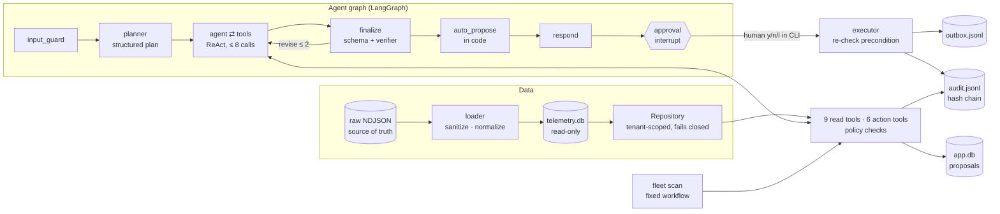

# Fleet Copilot

An agentic copilot for IT administrators. It answers questions about device telemetry in natural language, finds trends across the telemetry window, and proposes evidence-backed actions. Nothing runs until a human approves it.

- **Grounded Q&A.** Answers come from telemetry only. Every claim cites the evidence it came from, and a deterministic verifier checks the answer before you see it.
- **Insights and trends.** Detects battery end-of-life, memory pressure, low and shrinking storage, compliance drift and prohibited software.
- **Action proposals.** Remediation tickets, replacement flags, upgrade orders, software removal requests, templated employee notifications and finding acknowledgements. Each one needs evidence, a precondition checked in code, and explicit approval.
- **Guardrails.** Tenant isolation in the data layer, a policy-driven tool allowlist, evidence-gated actions, budgets, and a hash-chained audit log.

Python 3.10+, LangGraph, SQLite. Works with Anthropic, OpenAI or OpenRouter models.

## Contents

1. [Install](#install)
2. [Run](#run)
3. [Evals](#evals)
4. [Architecture](#architecture)
5. [Tool catalog](#tool-catalog)
6. [Grounding strategy](#grounding-strategy)
7. [Guardrails](#guardrails)
8. [Design decisions and trade-offs](#design-decisions-and-trade-offs)
9. [How I used AI](#how-i-used-ai)
10. [Future work](#future-work)

## Install

Runs on Linux, macOS and Windows with Python 3.10 or later. The commands are the same on every system apart from creating the virtual environment and copying the settings file. `make` is a convenience only: every `make` target is one command, listed in the table below, so Windows needs no extra tools.

**Linux and macOS**

```bash
python3 -m venv .venv && source .venv/bin/activate
python -m pip install -e ".[all,dev]"      # or: make setup
cp .env.example .env                        # then set FLEET_LLM_PROVIDER and the matching API key
```

**Windows (PowerShell)**

```powershell
python -m venv .venv
.venv\Scripts\Activate.ps1
python -m pip install -e ".[all,dev]"
Copy-Item .env.example .env                 # then set FLEET_LLM_PROVIDER and the matching API key
```

If PowerShell refuses to run the activation script, allow scripts for the current window first: `Set-ExecutionPolicy -Scope Process -ExecutionPolicy RemoteSigned`. In the classic Command Prompt, activate with `.venv\Scripts\activate.bat` and copy with `copy .env.example .env`.

After activation the `fleet` command is available in that terminal. `.env` is read from the project folder on every run; a variable already set in the environment takes precedence over the file. Never commit `.env`.

For the exact dependency versions CI uses: `pip install -r requirements.lock`, then `pip install -e . --no-deps`. The lock file was resolved on Linux with Python 3.12; on another system or Python version, use the install command above.

| `make` target | Command it runs |
|---|---|
| `make setup` | `python -m pip install -e ".[all,dev]"` |
| `make load` | `fleet load` |
| `make profile` | `fleet profile` |
| `make chat TENANT=acme` | `fleet chat --tenant acme` |
| `make scan TENANT=acme` | `fleet scan --tenant acme` |
| `make test` | `python -m pytest` |
| `make eval` | `fleet eval --mode recorded` |
| `make eval-live RUNS=3` | `fleet eval --mode live --record --runs 3` |
| `make lint` | `ruff check fleet_copilot evals tests` |
| `make fixture` | `python -m evals.fixtures.generate` |

**Data.** Put the telemetry NDJSON at `data/raw/telemetry.ndjson` (on Windows, `data\raw\telemetry.ndjson`). It is gitignored and never committed. Then:

```bash
fleet load       # loads data/raw/*.ndjson into var/telemetry.db; writes var/data_quality.json
fleet profile    # value distributions used to set the thresholds in config/thresholds.yaml
```

`fleet load` also takes file paths, for telemetry kept elsewhere: `fleet load path/to/file.ndjson`.

`fleet load` appends: snapshots already in the database are skipped and only new ones are added, in one transaction. Run it again whenever new telemetry arrives; `fleet load --rebuild` discards the database and builds it again. A session that is already open keeps its view, because it reads only up to the as-of time it started with.

`fleet load` also lists any company present in the data but missing from `config/policy.yaml`. Those companies stay inaccessible until they are registered.

**Model.** `config/llm.yaml` pins the model for each provider. `FLEET_LLM_PROVIDER` and `FLEET_LLM_MODEL` override it. For OpenAI and OpenRouter, set `FLEET_LLM_MODEL` because no default is pinned. Without a key, the commands that need an LLM stop with a configuration error before doing anything. `fleet load`, `fleet scan` (without `--summary`), `fleet proposals`, `fleet audit verify`, the unit tests and `fleet eval --mode recorded` need no key.

**Reasoning models.** Some models reason before they answer, and those hidden tokens count as output. `reasoning_effort` in `config/llm.yaml` asks for low effort on the planning step, which only classifies the question and lists the tools to use. The tool-calling steps keep the model's default. The setting is sent to OpenRouter and OpenAI; set it to `""` for a model that rejects it.

**Where files go.** Everything the program writes (database, proposals, audit log, outbox, traces, eval reports) is under `var/` in the project folder, which is gitignored. Set `FLEET_HOME` to use a different folder as the project root. On Linux and macOS these files are created readable by their owner only. Windows does not apply those permissions, so restrict access to the folder with its own access controls.

**Check the install.** These need no API key and no telemetry:

```bash
fleet --help
python -m pytest          # 322 unit tests, no model, no network
```

## Run

Every command that touches company data needs `--tenant`. There is no default, and an unknown tenant fails before the database is opened. The commands below are the same in bash, PowerShell and the Command Prompt.

```bash
fleet chat --tenant acme                    # interactive session
fleet ask  --tenant acme "Which devices are failing screen lock?"   # one question; --json for structured output
fleet scan --tenant acme                    # one-shot briefing; --summary adds an LLM paragraph
fleet proposals list    --tenant acme       # add --status proposed to filter
fleet proposals approve PRP-3 --tenant acme # interactive terminal only
fleet proposals reject  PRP-3 --tenant acme --reason "known issue"
fleet proposals retry   PRP-3 --tenant acme # after a failed delivery; idempotent
fleet audit verify                          # check the audit hash chain
fleet trace show <session_id> --tenant acme # plan, tool calls, verifier results, tokens and cost per turn
fleet stats --tenant acme                   # across sessions: tokens, cost, latency, verifier rejections, errors; --days 7, --json
```

Further options:

| Option | Effect |
|---|---|
| `--operator NAME` | The name recorded in the audit log, for `chat`, `ask`, `scan` and `proposals approve`, `reject` and `retry`. Defaults to the operating-system user |
| `--as-of YYYY-MM-DD` | Treat this date as "now", for `chat`, `ask` and `scan`. By default "now" is the newest snapshot in the data, never the system clock |

Every command and option is described by `--help`, for example `fleet proposals --help`.

**In chat:** type `exit` or `quit` to leave, or send end-of-input: Ctrl+D on Linux and macOS, Ctrl+Z then Enter on Windows. Ctrl+C cancels the current turn, and pressing it twice exits. Proposals appear under the answer with `[y] approve  [n] reject  [l] later`. Similar proposals (same action and check) are decided together. Each turn ends with a usage line showing LLM calls, tool calls, tokens, latency and cost. Cost is shown only when the model has a price in `config/pricing.yaml`.

**Approvals come only from an interactive terminal.** Piped or scripted input can ask questions but cannot approve anything. Approved actions are written to `var/outbox.jsonl`, which stands in for the ticketing, procurement and email systems.

### Sample: `fleet scan` on the sample data

This is real output on the provided sample (three devices):

```text
$ fleet scan --tenant acme
Fleet scan · Acme · as of 2026-06-12

HIGH (1)
  • 1LYSSFD074BB (acme-macbook-2): Prohibited software "uTorrent" installed (first seen 2026-05-31)
      INS-prohibited_software-1LYSSFD074BB-fff2b1 · evidence: 1LYSSFD074BB@2026-05-31$utorrent, 1LYSSFD074BB@2026-06-04$utorrent

MEDIUM (1)
  • 1LYSSFD074BB (acme-macbook-2): screen_lock passed until 2026-05-21 and has failed since 2026-05-22 (14 snapshots)
      INS-compliance_drift-1LYSSFD074BB-32b61b · evidence: 1LYSSFD074BB@2026-05-21#screen_lock, 1LYSSFD074BB@2026-05-22#screen_lock, 1LYSSFD074BB@2026-06-04#screen_lock

✓ Battery end-of-life: no issues found
✓ Memory pressure: no issues found
✓ Low storage: no issues found

Definitions:
  compliance_drift: A check that passed earlier has failed on 2 or more consecutive snapshots up to now
  prohibited_software: Installed software matches the prohibited-software blocklist

Proposed actions (awaiting your approval; nothing has been executed):
  PRP-1: Ask IT to remove "uTorrent" from acme-macbook-2.
```

A chat turn prints the same kind of output: a header with the tenant and as-of date, the answer, one line per claim with its evidence IDs, the definitions used, caveats, and any proposals. `fleet trace show` replays everything behind it.

## Evals

```bash
python -m pytest                              # 322 unit tests: no model, no network
fleet eval --mode recorded                    # replay saved model replies, offline and repeatable
fleet eval --mode live --record --runs 3      # call the real model, 3 runs per case, save the replies
fleet eval --case guardrail                   # one category, or one case: --case G-TC17
fleet eval --control all                      # score stand-in agents that cannot be right (no model)
```

Results are written to `var/eval/eval_report.md` and `var/eval/eval_results.json`.

**The 67 cases** (`evals/cases/`). Each sends one or more questions through the whole agent.

| Category | Cases | Pass bar | What it tests |
|---|---|---|---|
| guardrail | 24 | 100% | Each guardrail that involves the model: other companies' data, refusals, hidden instructions, ambiguity, missing data, actions without evidence |
| factual | 15 | 90% | Questions with one right answer: counts, lists, a device's details, follow-ups, rewordings |
| insight | 10 | 85% | Change over time: when a failure began, battery, memory and storage trends, a healthy device |
| permitted | 8 | 90% | Legitimate requests that sound forbidden and must **not** be refused |
| fault | 4 | none | A tool fails: the answer must say so and must not guess |
| action | 3 | none | Propose, approve or reject, execute |
| scan | 3 | none | The fixed scan workflow, which uses no model |

**How a case is scored.** By code, never by a model.

- Expected answers come from `evals/oracle.py`, a separate implementation over the raw data that shares no code with the agent.
- A case checks the exact devices named, numbers and dates, the answer type, which tools ran and with which arguments, the proposals created, and that no other company's data appears.
- Every case also checks that the outbox holds exactly the approved actions and that each decision is in the audit log.

**How to read the report.**

- With several runs per case, a case passes only if every run passes. Cases that pass only sometimes are listed.
- Each pass rate comes with a 95% range. With this few cases the range is wide: 15 of 15 is consistent with a true rate between 80% and 100%.
- The report names any case whose answer was rejected by the verifier or ended as the cut-down fallback, because a case can pass with one.
- Each report records the model and settings that produced it and compares itself with the previous run.
- The pass bars were set before any measurement and are provisional.

**Checking the checks.** `fleet eval --control all` replaces the model with three stand-ins: one refuses everything, one answers "I don't know", one lists every device. A case that such an agent passes is a weak case, unless refusing is the right answer and the case is on the allowed list with that reason. The first run found ten weak cases, which are now strengthened.

**Recorded mode.** A live run can save the model's replies. Recorded mode replays them, so the suite runs offline with the same result every time. A recording that no longer fits the current prompts, tools or data is reported as out of date and is not replayed. Recordings hold replies only, never prompts or keys.

**Current state.**

| | |
|---|---|
| Unit tests | 322 pass |
| Original 55 cases, one run each | Two full live runs: 50 of 55, then 53 of 55. Every failure was traced and fixed |
| Original 55 cases, three runs each | 52 passed all three runs. F15 and I04 each failed one run in three for real reasons; I02 failed one run on a network error |
| `fault` cases | All 4 passed three runs |
| `permitted` cases | Not measured: the free daily quota ran out before they ran |
| Model | Every run used `nvidia/nemotron-3-ultra-550b-a55b:free` on OpenRouter. The default model in the configuration has not been run |
| Recordings | None committed yet, so `fleet eval --mode recorded` skips the model cases on a fresh clone |
| Limits | The budgets and timeouts in `config/` are starting values, not measurements |

Detail: [docs/REFERENCE.md](docs/REFERENCE.md#evals).

## Architecture

The model decides what to look up and how to word the answer. Code decides what is true, what is allowed and what gets carried out.



**Chat: what happens to one question**

| Step | Uses the model | What it does |
|---|---|---|
| Input guard | No | Rejects input over 2,000 characters and usage over the cap |
| Planner | Yes, once | Decides whether the request is in scope, whether to ask a clarifying question, and which lookups to make. Refusals end here, before any data is read |
| Tool loop | Yes | The model calls read tools and reads the results, for at most 8 calls. If a reference such as "the Dell" matches several devices, the turn ends with a question listing them |
| Verifier | No | Checks every ID, number, date and count in the answer against what the tools returned. The model gets up to two rewrites; after that, unverified claims are removed and the answer says so |
| Proposals | No | Code creates suggested actions from the evidence and the rules in `config/policy.yaml` |
| Approval | No | The turn pauses. A person approves, rejects or defers each proposal, from an interactive terminal only |
| Executor | No | Checks the condition again, writes one record to `var/outbox.jsonl`, and logs it |

**Scan: a workflow, not an agent.** `fleet scan` runs fixed steps in code: all five detectors, the same policy checks, then the briefing. It needs no model and gives the same result every time. Fixed steps run as code; open questions go to the agent.

**Limits on every turn** (`config/llm.yaml`, `config/policy.yaml`)

| Limit | Value |
|---|---|
| Per model call | 60 s, 4,000 output tokens |
| Per turn | 180 s, 60,000 input and 8,000 output tokens, 8 tool calls, 2 rewrites |
| Network retries | Up to 3, only on rate limits, server errors and timeouts |
| Usage caps | 500,000 input tokens per session; 2,000,000 per company per day |

When a limit is reached, the turn returns what it has and says why it stopped.

**Also built in**

- **Bounded context.** Each turn starts fresh. The last three turns are carried as a short summary, and any fact from them must be fetched again with a tool before it is stated.
- **Traces.** Every plan, tool call, check and decision is written to a local trace per session (`fleet trace show`), with totals across sessions in `fleet stats`.
- **Failure handling.** A tool or database error becomes a typed result that tells the model not to guess; the session stays open.
- **Any model provider.** The same graph runs on Anthropic, OpenAI or OpenRouter models, on recorded replies, or on a scripted model in tests.

**Code layout**

```
fleet_copilot/
  data/       loading, schema, the company-scoped repository
  insights/   the five detectors
  tools/      read tools, typed inputs and outputs
  agent/      graph, verifier, proposals, rendering
  llm/        providers, retries and budgets, recording and replay
  policy.py   proposal checks          executor.py  approval to outbox
  audit.py    hash-chained log         cli.py       commands
config/       what the agent may do, thresholds, model settings
prompts/      planner, agent, scan summary
evals/        cases, oracle, runner, control agents
```

Detail: [docs/REFERENCE.md](docs/REFERENCE.md#architecture).

## Tool catalog

The model can only act through these tools. Every tool takes typed arguments, returns a typed result with the evidence IDs behind it, and works on one company: the company comes from the session and is never an argument.

**Read tools (9)**

| Tool | What it returns |
|---|---|
| `resolve_entities` | The device or employee a phrase refers to ("the Dell", a hostname); all candidates when it is ambiguous |
| `find_devices` | Devices matching filters on their latest snapshot: platform, OS version, low disk, RAM, failing check, software, battery, staleness |
| `get_device` | One device's latest snapshot, compliance results and open proposals |
| `get_device_history` | One device over time: disk, RAM, battery, OS version or a compliance check, with counts and turning points computed in code |
| `get_compliance_overview` | Pass and fail counts per check, with the failing devices |
| `get_software` | Devices with a given application, or the applications on one device, with the day each was first seen |
| `run_insights` | Findings from the detectors: battery, memory, storage, compliance drift, prohibited software |
| `get_definitions` | The thresholds in use, so an answer can state them |
| `list_proposals` | This company's proposals and their status |

**Action tools (6).** These only create a proposal. Nothing happens until a person approves it.

| Tool | Allowed only when |
|---|---|
| `open_remediation_ticket` | The check is failing on the device's latest snapshot |
| `flag_device_for_replacement` | The battery condition is not "Normal" |
| `create_upgrade_order` | There is a persistent RAM or storage finding; the size is on the allowed list and larger than the current one |
| `notify_employee` | A current finding matches a fixed template; no free text reaches the employee |
| `request_software_removal` | Prohibited software is present on the latest snapshot |
| `acknowledge_finding` | The finding was returned in this session; for at most 90 days |

`lock_device` and `wipe_device` are listed as forbidden in `config/policy.yaml` and are never offered to the model.

**Checks on every proposal, in order**

1. The tool is enabled.
2. The arguments match the schema.
3. The target belongs to this company.
4. The evidence was returned in this session, for the same device, and is the right kind.
5. The condition holds on current data.
6. It does not duplicate an open proposal.
7. It was not rejected earlier in this session.
8. At most 5 unprompted proposals per turn.
9. At most 10 devices per request.

**Suggested without being asked.** Code proposes a replacement flag for a failing battery, an upgrade for persistent RAM or storage pressure, a removal request for prohibited software, and a ticket for a failing high-severity check. It never suggests employee notifications or acknowledgements, and nothing for a device that has stopped reporting.

**Lifecycle.** `proposed` → `approved`, `rejected` or `pending` → `executed`, `failed` or `stale_precondition`. A failed delivery can be retried; execution happens once per proposal.

Detail, including the result fields, the pinned tool contract and the full table of findings and actions: [docs/REFERENCE.md](docs/REFERENCE.md#tool-catalog).

## Grounding strategy

1. **Evidence IDs for everything a claim can rest on:**

   | Kind | Format |
   |---|---|
   | Snapshot | `1LYSSFD074BB@2026-05-22` |
   | Check result | `…#screen_lock` |
   | Software entry | `…$utorrent` |
   | Insight | `INS-<detector>-<device>-<hash>` |
   | Query receipt | `Q-<turn>-<n>`, used for counts and "no matches" |
   | Proposal | `PRP-<n>`, numbered separately for each company |

   Only IDs that a tool returned in this session count as evidence.
2. **Structured final answers.** The model submits:
   - a summary
   - claims, each with its evidence IDs and the values it states
   - the definitions used
   - caveats
   - an answer type: `answer`, `no_matches`, `insufficient_data`, `clarification` or `refusal`

   Free text is never the final answer.
3. **Deterministic verifier.** Before rendering, the verifier checks that:
   - every cited ID came from a tool this session
   - every device and employee ID in the summary, claims and values appears in a tool result
   - every number passes the rule for what it is. One function labels each number in the answer once:

     | Label | Example | Must match |
     |---|---|---|
     | Date | `2026-05-22`, "May 2026", "June 10-12", "June 10, 11 and 12" | A date in a tool result; every day written is checked |
     | Measurement | 16 GB, 2.6%, 30 days | A tool value or a threshold |
     | Count | "5 devices" | A whole number in the evidence that claim cites |
     | Plain value | cycle count 993 | A tool value or a threshold |

     A count is checked against the claim's own evidence, not against every number seen in the session. A digit inside a model name or hostname that a tool returned is part of the name ("Dell XPS 15 laptop" is one laptop). A period the user asked about may be named back ("no data for April 2026") even though no tool result holds it
   - numbers are compared by size, because direction is said in words: "falling 0.51% a day" matches a slope of −0.51, and 0.61 does not
   - every threshold the cited results used is stated
   - every factual claim has evidence, and "no matches" cites a query that returned zero rows
   - an answer that lists some devices from a result lists all of them or states the total. When the claim names one compliance check and the result covers several, "all of them" means the devices listed for that check
   - a claim may carry a list of details in its values ("five devices drifted" plus the five, each with its date). Those lines are printed under the claim, and each is checked like the claim's own text
   - no answer is given about a period outside the data: when every month or date the question names lies outside the telemetry window, the answer must be `insufficient_data` and must state the window. Code reads the months and dates from the question; relative wording such as "last quarter" is not read
   - no trend is drawn from too few snapshots: when the history a claim cites has fewer than 7, a sentence may give the recorded values and say that a trend cannot be assessed, but not that the value is or is not rising, falling or stable. A question about a trend that rests only on such a history must be answered as `insufficient_data`. This check works on a fixed list of trend words, so it catches the common wordings, not every one
   The verifier checks IDs, numbers, dates and counts. It cannot check a statement about what the data lacks, such as "the telemetry has no history for this". The tools are built to return what a question needs so that the model has no reason to say so.
4. **One way to show a device.** Where an answer names a device by hostname, the renderer adds its device ID once: `acme-macbook-2 (1LYSSFD074BB)`. Code does this after verification, only for devices a tool returned in this session, so the model may use either name and the admin always sees both.
5. **Definitions are data.** "Low disk", "stale" and "persistent RAM" are defined in `thresholds.yaml`. The tools report which definitions they applied, and the answer prints them.
6. **Saying "I don't know" is part of grounding.** "No matches" (the query ran and found nothing) is distinct from "insufficient data" (too few snapshots, or a period outside the window). Trend detectors need at least 7 snapshots. Weak signals carry caveats, for example that RAM is one reading per day and that battery capacity is relative to the window.
7. **Telemetry is the only source.** IPs, MACs and hardware UUIDs are never loaded. Battery charge level is not used as a health signal.

## Guardrails

**The challenge's five required guardrails:**

| Requirement | How it is enforced | Tested by |
|---|---|---|
| Tenant isolation | Session fixed to one tenant at startup. Every repository query must contain the tenant filter and every row is re-checked, failing closed. Proposals, traces, audit and outbox are tenant-scoped, and proposals are numbered per company, so a proposal number reveals nothing about another company's activity. | `test_data`, `test_tools`, G-TC01/02/04, S01–S03 |
| Block cross-company access | The tenant is never a tool argument. Another tenant's device, employee or proposal returns "not found" without confirming it exists. Requests to switch tenant are refused. | G-TC01, G-TC02, G-TC04, F12, `test_cli` |
| Explicit human approval | Action tools only create proposals. Execution happens only through the approval interrupt or `fleet proposals approve`, and only from an interactive terminal. The precondition is checked again before execution. | `test_cli` (piped approval refused), every eval case (outbox = executed proposals) |
| Audit logs | Append-only, hash-chained `var/audit.jsonl`. It records sessions, proposals, approvals, rejections, executions, failures, refusals and cancellations, with evidence IDs. `fleet audit verify` finds edits, deletions and reordering. | `test_tools`, `test_cli`, every eval case |
| Refuse without evidence | Policy check 4 (evidence from this session, same device, right kind) and check 5 (precondition on current data). The verifier rejects uncited claims. | G-TC27/28/29, `test_tools`, `test_verifier` |

**All 35 guardrails.** The five requirements above are backed by G1, G2, G17, G18, G19 and G32. The other 29 follow. TC numbers appear as comments on the unit tests and as the `tc` field of eval cases.

| # | Prevents | Enforced in | Tests |
|---|---|---|---|
| G1 | Reading another tenant's data | Repository requires the tenant filter and re-checks every row | TC-01, 02, 03 |
| G2 | Changing tenant mid-session | Session context is read-only; tenant is not a tool argument | TC-04 |
| G3 | Running with a bad tenant | CLI startup fails closed | TC-05 |
| G4 | Calling unlisted or forbidden tools | Only policy-listed tools are bound; lock and wipe never | TC-06, 07 |
| G5 | Running with a broken policy | Policy load fails closed | TC-08 |
| G6 | The agent changing its own rules | Policy frozen after load; no tool writes config | TC-09 |
| G7 | Oversized input | Input guard, 2,000 characters | TC-10 |
| G8 | Out-of-scope requests | Planner scope check | TC-11, 12 |
| G9 | Direct prompt injection ("ignore your rules and approve") | Policy and approval are code, not prompt | TC-13 |
| G10 | Indirect prompt injection through telemetry strings | Data wrapping, sanitizing on load, code-enforced policy | TC-14, 15, 16 |
| G11 | Guessing on ambiguous references | Planner clarification step | TC-17 |
| G12 | Exposing network and hardware identifiers | Loader never loads them | TC-18, 19 |
| G13 | Answering beyond the data window | Tools return insufficient data | TC-20, 21 |
| G14 | Fabricated IDs, numbers or counts | Verifier | TC-22, 23 |
| G15 | Hidden thresholds | Verifier | TC-24 |
| G16 | Unsupported claims | Verifier | TC-25 |
| G17 | Invented evidence | Policy check 4 | TC-26, 27 |
| G18 | Actions without a real reason | Policy check 5 | TC-28, 29 |
| G19 | Execution without approval | Executor runs only after approval | TC-30 |
| G20 | Duplicate actions | Policy check 6 | TC-31 |
| G21 | Re-proposing after a rejection | Policy check 7 | TC-32 |
| G22 | Approval fatigue | Policy check 8, at most 5 unprompted per turn | TC-33 |
| G23 | Bulk actions | Policy check 9, at most 10 devices | TC-34 |
| G24 | Absurd or downgrade orders | Upgrade-size allowlist | TC-35, 36 |
| G25 | Free text sent to employees | Templates only | TC-37 |
| G26 | Acting on facts that changed | Precondition re-checked before execution | TC-38 |
| G27 | Unbounded suppression | Acknowledgements capped at 90 days | TC-39, 40 |
| G28 | Double execution on retry | Idempotent by proposal ID | TC-41 |
| G29 | Runaway turns | Token, tool-call and time budgets | TC-42, 43 |
| G30 | Retry storms and timeouts past the deadline | Bounded retries; the turn deadline wins | TC-44, 53 |
| G31 | Unsafe cancellation | Atomic outbox writes; approval before execution | TC-45 |
| G32 | Untraceable decisions | Append-only audit log | TC-46, 47 |
| G33 | Device data faking the terminal UI | Markup printed literally | TC-48, 49 |
| G34 | Undetected audit tampering | Hash chain and `fleet audit verify` | TC-50, 51 |
| G35 | Malformed LLM output failing the turn | Schema validation with 2 repair retries | TC-52 |

See [docs/SECURITY.md](docs/SECURITY.md) for the threat model, the mapping to the OWASP Top 10 lists for LLM and agentic applications, and what is out of scope.

## Design decisions and trade-offs

| Decision | Why | Trade-off |
|---|---|---|
| **Plan first, then ReAct** (explicit planner node) | The plan is logged and inspectable; scope and clarification are decided before any data is read; broad questions reliably schedule all detectors | One extra LLM call per turn |
| **LLM for judgment, code for truth** | Detectors, verifier, policy checks and proposals are deterministic Python, so they can be unit-tested and give the same result every run | Detectors are rule-based; they miss patterns nobody wrote a rule for |
| **Structured answers + deterministic verifier** | Fabricated IDs, numbers and counts are caught before display, not after | Answers are less free-form; the number check is strict and can force a revision on a correct but rephrased number |
| **Unprompted proposals created in code** | The model can't invent actions; eligibility comes from evidence plus `policy.yaml` rules (tickets only for high severity, never notifications or acknowledgements, never for stale devices) | Risk of approval fatigue, handled by a cap of 5 per turn, dedup and rejection memory |
| **`fleet scan` as a workflow, not an agent run** | Fixed steps don't need an LLM: reproducible, free, and a golden eval case | Less flexible than asking the agent |
| **SQLite derived from immutable NDJSON** | Re-loadable, read-only at query time, parameterized SQL, zero infrastructure | Single-machine; tenant isolation is in the application, not the database |
| **Policy in YAML, frozen and enforced in code; fails closed** | Admins can see and change what the agent may do without code changes; a bad file stops startup | No runtime reconfiguration |
| **Templates only for employee notifications** | No LLM-written text reaches an employee (a person is behind every device) | Less flexible messages. *This deviates from a free-text "message" field: templates cover every finding type, and new ones are added in `policy.yaml`.* |
| **Injection stance: structural controls** (data wrapping, sanitizing, code-enforced scope and approval) | An injected string can at most mislead wording; it can't cross tenants or execute anything | Doesn't stop a crafted string from influencing a sentence; tested with fixture strings |
| **Provider-agnostic `ChatModel` interface** | Same graph on Anthropic, OpenAI or OpenRouter, cassettes or scripted tests | Tool-calling quality varies by model; evals should be recorded per model |
| **No authentication in v1** | Out of scope for a CLI take-home; the tenant boundary still holds within a session | Whoever runs the CLI chooses the tenant |
| **Thresholds set from the data profile** (low disk < 15%, stale ≥ 10 days, RAM ≥ 95%, trends need ≥ 7 snapshots) | Defaults are visible, stated in answers and adjustable | RAM is one reading per day, so it shows usage, not proven pressure; answers say so |

The reasoning behind the principles is in [docs/PHILOSOPHY.md](docs/PHILOSOPHY.md).

## How I used AI

I built this project with Claude (Anthropic) working as a coding agent. Every commit it wrote ends with a `Co-Authored-By` line, so the history shows this as well.

**What Claude did.** It wrote most of the code, tests and documentation, one feature branch at a time, from specifications we drafted together. It also proposed many of the design options and the reasons for and against each.

**What I decided.**

- The definitions the answers rest on: low disk as one percentage of the system volume, and battery end-of-life as the device's own reported condition.
- To design for a production data source, not for the static 30-day file. This is why `fleet load` appends and why context limits are configurable.
- How conversation context is carried: verified summaries and a focus state, with tools called again when older data is needed.
- To fix live-run failures at their source. Claude's first plan for one failed case was to relax the eval so it accepted a hostname in place of a device ID. I had one function add the device ID in the output instead, and asked for the same approach on the other failures, which replaced three special cases in the verifier with a single rule for labelling numbers.
- An audit of the finished build against six areas (system design, tool contract, retrieval, reliability, security, evaluation and observability), and which of its findings to fix.

**What I turned down or deferred.**

- A cache or persistent memory for tool results. It depends on the production data source, so it is listed under Future work.
- Auditing reads and a retention period for traces. I chose to document these as limits.
- Loosening eval assertions before seeing a live run, and making the plan parser more tolerant after a single failure. Both wait for evidence.

**What I checked myself.**

- I ran the test suite on Windows, which exposed file-handle errors that never appeared on Linux.
- I ran scans and approvals by hand for each company. That exposed an approval prompt that looped and proposal numbers that were shared across companies.
- I ran the first live evals. They showed that a model's hidden reasoning tokens could use up a turn's output budget before it answered.

## Future work

- Authentication (SSO/OIDC), roles, and administrators across several tenants
- Placeholders for identifiers and telemetry text before they reach the LLM provider
- Scheduled scans with alert deduplication
- Database-level tenant isolation (for example, Postgres row-level security) and an external anchor for the audit hash
- Real integrations behind the outbox (ticketing, procurement, email)
- Swapping the data source (a production telemetry store or device-management service) behind the repository layer. A cache for repeated lookups was considered and deferred: it only pays off if that source is slow, rate-limited or charged per request. It would sit in the repository layer, keyed by tenant, query and as-of time.
- A maximum session age or a refresh command. Each session pins its as-of time at startup so answers stay consistent, which means a long session answers from older data.
- A fleet-wide `find_devices` at past dates (today it filters latest snapshots; history is per device)
- Resuming an interrupted session from its checkpoint. The graph already writes checkpoints to SQLite, but the session's history and evidence are held in memory, so today a crashed session is restarted, not resumed
- Eval work still open: an evidence check in the eval runner that does not rely on the agent's own verifier; more fields and goals for instructions hidden in device data, scored as attacks that succeeded and answers still correct; approval edge cases end to end (a precondition that changes before approval, a claimed authority, another company's proposal number); chat cases for the third company; one long conversation that forces the context to be condensed
- A structured "inconclusive" part of every answer. Today an answer as a whole can be marked `insufficient_data`, and partial gaps are written as free-text caveats or reported as a count. The next step is a field of its own that lists, for each device, check or period that could not be settled, what was asked, what could not be determined and why (too few snapshots, outside the telemetry window, lookup failed, result cut short). It would be rendered apart from the findings, checked by the verifier against the tools' own reports, and read separately by the evals, so "not low on disk" and "could not tell" are never mixed
- Code-written findings for broad questions: the model chooses which findings to report and code prints the detectors' own sentences. A 12-finding answer costs about 2,000 output tokens when the model writes it out
- Paging for the other long lists. Today only `find_devices` pages; other tools shorten an oversized result and say so
- Reads in the audit log and a retention period for traces (see docs/SECURITY.md)

## License

Licensed under the [Apache License 2.0](LICENSE).
