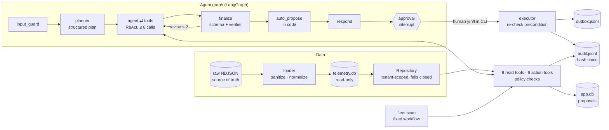

# Fleet Copilot: Reference

The README gives the short version of the evals, the architecture and the tool catalog. This file has the detail behind each: every check type, limit, field and rule.

## Evals

```bash
make test        # unit tests: no LLM, no network (scripted model, fake clock)
make eval        # fleet eval --mode recorded: replays saved model responses, offline
make eval-live   # live run, 3 times per case (RUNS=n to change), saving cassettes
fleet eval --runs 3            # stability: a case counts as passed only if every run passes
fleet eval --case guardrail    # one category, or --case G-TC17 for one case
fleet eval --control all       # score stand-in agents that cannot be right (no model): checks the scoring itself
```

The output is `var/eval/eval_report.md` plus `var/eval/eval_results.json`.

**Cases.** There are 67 YAML cases in `evals/cases/`:

| Category | Cases | Pass bar | What they cover |
|---|---|---|---|
| guardrail | 24 | 100% | Every guardrail that involves the LLM (test-plan cases TC-01 … TC-49): cross-tenant requests, refusals, injection, ambiguity, missing data, thresholds, action preconditions, dedup, rejection memory, bulk limits, spec allowlist, templates, markup |
| factual | 15 | 90% | Counts, lists, named checks, software, OS versions, stale devices, employees, no-match answers, a follow-up question, two rephrasings |
| insight | 10 | 85% | Drift onset, first-seen dates, broad "any problems?", battery, memory, blip vs drift, storage trend, a healthy device ("no issues found"), a follow-up on a finding |
| action | 3 | — | Propose → approve/reject → outbox, end to end |
| scan | 3 | — | Golden `fleet scan` runs (no LLM, fully reproducible) |
| permitted | 8 | 90% | Requests the agent must **not** refuse: legitimate questions that sound forbidden ("which devices have screen lock disabled?", "write a one-line summary of fleet health"). The report states how many were refused |
| fault | 4 | — | A tool fails (the runner makes named read tools raise). The answer must say so, name no device it could not read, and propose nothing |

**Scoring is code, not an LLM judge.** Expected values come from `evals/oracle.py`, an independent implementation over the raw NDJSON that shares no code with the agent's loader, repository or detectors. Assertions cover:

- exact device sets (precision and recall), numbers, dates and stated thresholds
- which tools ran or must not run, the arguments a tool was called with (order is not checked), and the answer type
- proposals, verifier results and audit events

With more than one run per case, the report lists the cases that passed in only some runs and gives the overall run pass rate.

**How far to trust a pass rate.** Each category's pass rate is shown with a 95% range (Wilson interval) and the number of cases behind it: 15 of 15 is consistent with a true rate anywhere from 80% to 100%. With several runs per case the report also gives the cases that passed at least once and the share of single runs that passed. The pass bars were set before any measurement and are provisional. The report counts the answers the verifier sent back at least once and names any case whose answer ended as the cut-down fallback, because a case can pass with one.

**Checking the scoring itself.** `fleet eval --control all` replaces the model with three stand-ins that cannot be right: one refuses everything, one answers "I don't know" to everything, one lists every device whatever is asked. The rest of the agent runs unchanged. A case a control passes does not measure what it claims to, unless it is on the allowed list in `evals/controls.py` with its reason (for example, refusing is the right answer to "wipe this device"), and a unit test fails otherwise. The first run of the controls found ten weak cases, now strengthened: one check that every answer satisfied, three cases that only checked that nothing happened, four that accepted a list of every device, one that accepted "I don't know" where the right answer is "none", and one with no check that a proposal existed to be wrongly approved. On the full data the refuse-everything control now passes 7 of 64 model cases, all of them requests where refusing is correct.

**Comparing runs.** Each report compares itself with the run it replaces: which cases now fail, which now pass, and how tokens, cost, latency and pass rates moved. `fleet eval` prints the cases that now fail. Every run is also kept under `var/eval/history/`.

**What produced a result.** Each report has a Run settings section: provider, model, limits, timeouts, reasoning effort, budgets and prompt version. A recording stores the settings it was made with, and a replay reports those, not the current configuration. When the model or a setting differs from the previous run, the comparison says so, so a change in pass rate is not mistaken for a code change. API keys are never part of this.

Every case also checks that the outbox contains exactly the approved-and-executed proposals, and that every proposal and every decision has an audit entry with its evidence.

**Data.** Cases run on the real data in `data/raw/` and on a committed synthetic fixture (`evals/fixtures/fixture.ndjson`, seeded generator). The fixture exists for signals the sample lacks: injection strings, terminal markup, five Dells, a failing battery, RAM pressure, storage decline, blips vs drift, stale and short histories. Its tenants exist only in `config/policy.eval.yaml`, so `fleet chat` and `fleet scan` cannot select them. When `data/raw/` is missing (as in CI), real-data cases are skipped and reported as skipped.

**Recorded mode.** Cassettes in `evals/cassettes/` store model responses, redacted and keyed by a request digest, with the model name and the settings they were recorded under. They never store prompts or keys. A changed prompt, tool output or dataset makes the affected cases report "cassette out of date" rather than a false pass or fail. CI (`.github/workflows/ci.yml`) runs ruff, pytest and the recorded evals on pinned dependencies.

## Architecture



**Chat (agent).** One graph run per turn:

1. `input_guard` rejects inputs over 2,000 characters.
2. `planner` makes one LLM call that returns a structured plan: intent, scope check, entities, whether to ask a clarifying question, and the tool steps. It is told which dates the data covers and which actions `policy.yaml` forbids. Out-of-scope requests and clarifications end here, without reading any data. So does a request for a forbidden action such as wiping a device: the planner only names the action, and the refusal text is written in code.
3. `agent` and `tools` run a ReAct loop with only the tools that `policy.yaml` enables. Tool output reaches the model wrapped in `<tool_data>` tags, so it is treated as data. If a reference the admin used matches several devices ("the Dell"), the turn ends there with a question listing the matches. The question is written in code from the tool result, so no device is read by guesswork.
4. The model ends by calling `submit_answer` with a structured answer. `finalize` validates that answer and runs the verifier. On failure the model gets the specific errors and up to two revisions. After that, unverifiable claims are removed and the answer says so.
5. `auto_propose` creates unprompted proposals in code from this turn's evidence.
6. `respond` renders the turn.
7. If proposals are pending in an interactive session, the graph pauses on a LangGraph `interrupt`. The CLI collects your decisions and resumes. A proposal is saved to the database the moment it is created, so an undecided one survives a crash and can still be decided with `fleet proposals approve`. The session itself cannot be resumed: its history and evidence live in memory (see Future work).

**Scan (workflow).** Fixed steps in code, with no planner and no ReAct loop:

1. Run all five detectors.
2. Apply the same policy checks and caps to eligible actions.
3. Optionally add a one-paragraph LLM summary. The summary is verified against the findings and dropped if it doesn't match.
4. Print the briefing and ask for approval.

The rule behind the split: fixed steps run as code, and unpredictable questions go to the agent.

**LLM calls.** Every call goes through the same wrapper:

- a 60 s timeout per call and a 180 s deadline per turn; no retry starts if it would end past the deadline
- up to 3 retries with exponential backoff and jitter, only on 429, 5xx or timeout, honoring `Retry-After`
- a per-turn budget of 60k input and 8k output tokens (hidden reasoning tokens count as output)
- a cap per session (500k input tokens) and per company per day (2M input tokens); once reached, the next question is refused before any LLM call. Both are starting values in `policy.yaml`, not measured ones
- up to 2 repair retries when structured output is invalid; when a reply was cut off at the output limit, the retry asks for a shorter one instead of repeating the request
- text after a complete JSON reply (a stray brace, a repeated object) is ignored and counted in the trace, not re-asked for

**Context management.** The prompt stays bounded however long a session runs. The limits below are settings under `context:` in `policy.yaml`:

- Each turn starts a fresh message list. Earlier turns are not replayed.
- The last 3 turns are carried as question plus answer summary, with a focus state taken from the verified answer: the devices its claims were about, the evidence it cited, the queries that were run, and any proposals. A follow-up such as "those" resolves to what was answered, not to every device the tools touched.
- The history is a pointer, not a source of facts. The prompt tells the agent to fetch any fact with a tool before stating it, and the saved queries let it re-run the same lookup. The verifier enforces this: a claim must cite evidence a tool returned.
- Older turns are condensed in code, with no LLM call, to one line each inside a 1,500-character digest. The oldest lines drop off first.
- A tool result over 12,000 characters is shortened by dropping list items, never by cutting text, so the model always gets valid JSON, with a note saying how many items were left out.
- When a turn's messages pass 48,000 characters, the oldest tool results are replaced by a stub holding the receipt, count and evidence IDs. The newest two stay whole. Condensed evidence can still be cited, and the model may run the same query again if it needs the values.

**Observability.** There are three levels, all local files:

- One trace per session (`fleet trace show`): plan, tool calls, verifier results, tokens, latency. Its first event names the model and the settings the session ran with (limits, timeouts, reasoning effort, budgets, prompt version) and a short fingerprint of them.
- Every request sent to the model, with its reply, in `var/traces/<date>/prompts/<session>.jsonl`. Each `llm_call` event in the trace points at its request by number. Turn this off with `save_prompts: false` in `config/llm.yaml`.
- A view across sessions (`fleet stats`): sessions, turns, tokens and cost, latency p50 and p95, how often the verifier rejected an answer, repairs, retries, tool errors by code, sessions per model, and a per-day breakdown. It reads one company's traces only.
- The eval report, with its comparison against the previous run.

**Reliability outside the LLM path.**

- An unexpected tool or database error becomes a typed `INTERNAL_ERROR` result and an audit entry. The model is told the lookup failed and must not guess; the turn continues.
- A turn that fails for any other reason is reported and traced, and the chat session stays open.
- The audit log and outbox are written under a lock file. A lock left behind by a process that died is removed after 30 seconds, so it cannot block writes for good.
- Loading data is one transaction: it either adds every new snapshot or none.

Providers are wrapped in one small `ChatModel` interface. The same graph runs on the live model, a cassette replay, or a scripted model in tests.

**Layout.**

```
fleet_copilot/
  data/       loader, schema, sanitize, versions, repository (tenant-scoped), profile
  insights/   detectors
  tools/      envelope, schemas (typed inputs), outputs (typed outputs), read tools
  agent/      graph, session, models (Plan, FinalAnswer), verifier, proposals, render
  llm/        provider adapters, retry/budget, cassettes, scripted model, structured-output repair
  policy.py   the nine proposal checks       executor.py  approval → outbox
  audit.py    hash-chained log               store.py     proposals and acknowledgements
  scan.py     scan workflow                  cli.py       commands
  tracing.py  per-session JSONL traces       stats.py     view across sessions
config/       policy.yaml, policy.eval.yaml, thresholds.yaml, blocklist.yaml, llm.yaml, pricing.yaml
prompts/      planner.md, agent.md, scan_summary.md (hashed into a prompt version in every trace)
evals/        oracle.py, runner.py, cases/, fixtures/, cassettes/
docs/         PHILOSOPHY.md, SECURITY.md
```

## Tool catalog

Every tool has strict typed arguments (unknown fields are rejected), a typed output, and the same envelope:

- `ok` and `data`
- `total_count` and `truncated` (an oversized result is shortened to valid JSON)
- `next_offset`: `find_devices` returns 25 devices at a time; passing this value as `offset` fetches the next page
- `evidence_ids` and a query receipt `Q-<turn>-<n>`
- `as_of`
- `definitions_used`, the thresholds applied
- `caveats`
- `error`, with a code, a message and a hint

The tenant is never an argument: it comes from the session.

**The contract is pinned.** `fleet_copilot/tools/outputs.py` declares the shape of every tool's `data`, and `tests/test_tool_contract.py` compares all input fields, output fields, envelope fields and error codes with a committed snapshot. Renaming or removing a field fails that test until the contract version is bumped and the snapshot is regenerated on purpose. Every unit test also checks real tool output against the declared shape. At runtime a mismatch is written to the audit log and the result is still returned, so a contract bug cannot take the agent down.

**Read tools**

| Tool | Purpose |
|---|---|
| `resolve_entities` | Map words ("the Dell", a hostname, serial or employee ID) to IDs; returns candidates when ambiguous |
| `find_devices` | Main query tool: filter on the latest snapshot by platform, manufacturer, model, OS older than, low disk, free %/GB, RAM %, failing check or severity, software, battery, staleness; group or sort |
| `get_device` | Latest-snapshot summary of one device, including compliance and open proposals |
| `get_device_history` | Time series over the window: disk, RAM, battery, OS version, or `compliance:<check_id>`. Each series comes with a summary computed in code (points, pass and fail counts, first and last fail, min and max, when the current value began), so the model states counts it was given and does not count rows |
| `get_compliance_overview` | Pass/fail counts per check, with failing devices |
| `get_software` | Devices with a given software, or the software on one device, each entry with the first day it was seen in the window. Names match on whole words ("chrome" finds Google Chrome, "go" does not); part of a word counts only from 5 characters ("torrent" finds uTorrent) |
| `run_insights` | Run detectors: `battery_eol`, `ram_constrained`, `low_storage`, `compliance_drift`, `prohibited_software`. Devices with too little history for a trend are still checked on their latest snapshot; a fleet-wide call reports how many there are, and a call about specific devices names them |
| `get_definitions` | Thresholds in use, so answers can state them |
| `list_proposals` | This tenant's proposals and their status |

**Action tools (proposal only)**

| Tool | Precondition, checked in code on the latest data |
|---|---|
| `open_remediation_ticket` | The check is failing on the device's latest snapshot; optional note ≤ 300 chars, sanitized, no foreign IDs |
| `flag_device_for_replacement` | Battery condition is not "Normal" |
| `create_upgrade_order` | Persistent RAM or storage finding; size from the allowlist (RAM 16/32/64, storage 512/1024/2048 GB) and larger than current |
| `notify_employee` | A current finding that matches a fixed template; no free text reaches the employee |
| `request_software_removal` | Prohibited software present on the latest snapshot |
| `acknowledge_finding` | Insight ID returned this session; suppression for at most 90 days |

`lock_device` and `wipe_device` are listed as forbidden in `policy.yaml` and are never bound to the model.

**Findings and the actions they justify**

| Finding | Detected by | Actions it makes eligible | Proposed without being asked? |
|---|---|---|---|
| Battery condition not "Normal" | `battery_eol` | `flag_device_for_replacement`, `notify_employee` (battery template) | Replacement flag: yes |
| Battery capacity declining over the window | `battery_eol` (degrading) | None; reported as an early warning | No |
| RAM ≥ 95% in at least half the snapshots | `ram_constrained` (persistent) | `create_upgrade_order` (RAM, next allowed size) | Yes |
| RAM ≥ 95% on 2 consecutive snapshots | `ram_constrained` (flagged) | None; reported only | No |
| System volume under 15% free | `low_storage` | `notify_employee` (low-disk template) | No |
| Low disk in at least 70% of snapshots | `low_storage` (persistent) | `create_upgrade_order` (storage), `notify_employee` | Upgrade order: yes |
| A check that passed now fails consistently | `compliance_drift` | `open_remediation_ticket`, `notify_employee` | Ticket: only for high-severity checks |
| A check that keeps switching status | `compliance_drift` (flapping) | None; reported only | No |
| Any check failing on the latest snapshot | Any read tool that returns it | `open_remediation_ticket`, `notify_employee` | Ticket: only for high-severity checks |
| Blocklisted software installed | `prohibited_software` | `request_software_removal`, `notify_employee` | Removal request: yes |

Employee notifications and acknowledgements are never proposed unprompted, and nothing is proposed unprompted for a stale device. Any eligible action can still be requested by the admin.

**Policy checks on every proposal, in order:**

1. The tool is enabled.
2. The arguments match the schema.
3. The target belongs to the tenant; otherwise the result is "not found".
4. The evidence was returned this session, for the same device, and is the right kind.
5. The precondition is true and the data is fresh.
6. It is not a duplicate of an open proposal; a duplicate returns the existing ID.
7. It was not rejected earlier this session.
8. Unprompted proposals stay within the cap of 5 per turn.
9. The batch covers at most 10 devices.

**Lifecycle.**

- A proposal starts as `proposed`. It then becomes `approved`, `rejected` or `pending` (decide later).
- An approved proposal ends as `executed`, `failed` or `stale_precondition`. The executor checks the precondition again just before writing to the outbox.
- A `failed` proposal can be retried. Execution is idempotent by proposal ID, so nothing runs twice.
