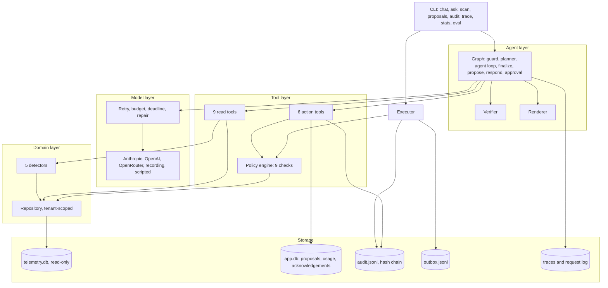
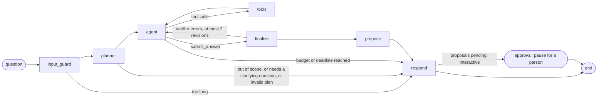
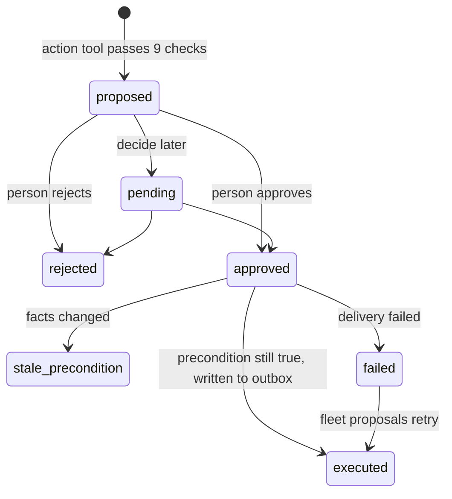

# Fleet Copilot: Architecture

This document describes how the system is built: its parts, how one question moves through them, where each guarantee is enforced, and where the design is weak. The README has the short version and the full tool and guardrail tables; this document does not repeat them.

Status: describes the code on `main` as of 2026-11-23.

## 1. The idea in one paragraph

An IT admin asks questions about one company's devices. A language model decides what to look up and how to word the answer. Everything that must be true or safe is done by ordinary code: reading the data, detecting problems, checking the answer against the data, deciding whether an action is allowed, and carrying an action out. The model can ask for data and can ask for an action to be proposed. It cannot read another company's data, cannot state a fact the code cannot trace to a tool result, and cannot make anything happen without a person approving it.

## 2. Layers

| Layer | Code | Responsibility |
|---|---|---|
| CLI | `cli.py` | Fixes the company for the session, runs turns, collects approvals from an interactive terminal |
| Agent | `agent/graph.py`, `agent/session.py`, `agent/verifier.py`, `agent/proposals.py`, `agent/render.py`, `agent/models.py` | The turn: plan, tool loop, answer check, unprompted proposals, output |
| Model | `llm/` | One `ChatModel` interface; timeouts, retries, budgets, repair of invalid output; recording and replay |
| Tools | `tools/`, `toolkit.py`, `policy.py` | Typed inputs and outputs, one result envelope, evidence IDs, proposal checks |
| Domain | `insights/detectors.py`, `data/repository.py` | Rule-based findings; every query scoped to one company |
| Storage | `data/loader.py`, `data/schema.py`, `store.py`, `audit.py`, `executor.py`, `tracing.py` | Derived database, proposals, audit log, outbox, traces |
| Configuration | `config/*.yaml`, `config.py` | What the agent may do, thresholds, model settings; loaded once, frozen, fails closed |

## 3. Data

**Source.** Raw NDJSON, one line per device per day, is the source of truth and is never changed. `fleet load` builds `var/telemetry.db` (SQLite) from it in one transaction. Loading again adds only new snapshots; `--rebuild` starts over.

**Tables.** `devices`, `snapshots`, `disk_volumes`, `software`, `compliance_results`, `meta`.

**At load time:**
- Values are derived once: manufacturer, laptop or not, system volume, parsed OS version, RAM used %, disk free %.
- Telemetry strings (hostnames, software names, model names) are cut to 100 characters and stripped of control characters, because they later reach both the model and the terminal.
- IP addresses, MAC addresses, network interfaces and hardware UUIDs are never loaded, so no later bug can expose them.
- A data-quality report is written (`var/data_quality.json`): duplicates, missing days, values that go backwards.

**Time.** "Now" is the newest snapshot in the data (or `--as-of`), never the system clock. Every answer states the date it is as of. This makes answers repeatable.

**Company scope.** The repository is created for one company. Every query must carry the company filter and every returned row is checked again; a mismatch is an error, not an empty result. The company is never a tool argument, so the model has no field through which to ask for another one.

## 4. One turn of chat

One turn is one user question. The graph runs once per turn.

| Step | Uses the model | What it does |
|---|---|---|
| `input_guard` | No | Refuses input over 2,000 characters |
| `planner` | Yes, one call, low reasoning effort | Returns a structured plan: kind of question, in scope or not, entities, whether to ask a clarifying question, tool steps. Refusals and clarifications end here, before any data is read |
| `agent` and `tools` | Yes | Tool loop, at most 8 tool calls. Only the tools enabled in `policy.yaml` are offered. Results reach the model inside `<tool_data>` tags, marked as data |
| `finalize` | No | Validates the structured answer and runs the verifier. On failure the model gets the exact errors, up to 2 times. After that, claims that still fail are removed and the answer says so |
| `propose` | No | Creates unprompted proposals in code from this turn's evidence and the rules in `policy.yaml` |
| `respond` | No | Renders the answer, evidence and proposals. Escapes telemetry strings. Adds the device ID after a hostname |
| `approval` | No | Pauses the graph. The CLI asks approve, reject or later for each proposal |

**Why a separate planner.** The plan is logged and can be inspected. Scope and ambiguity are settled before data is read. Broad questions reliably schedule every detector. The cost is one extra model call per turn.

**Why the model ends with a tool call.** The final answer is a `submit_answer` call with fields (summary, claims with evidence IDs and values, definitions used, caveats, answer type). A fixed shape is what makes checking in code possible.

## 5. Grounding: how an answer is tied to the data

1. **Every tool result carries evidence IDs.** A snapshot is `DEVICE@DATE`, a compliance check `DEVICE@DATE#check`, a software entry `DEVICE@DATE$name`, a finding `INS-…`. A query that returns a count or a list also returns a receipt (`Q-<turn>-<n>`) that records what was asked and the whole numbers in the result.
2. **The session keeps what tools returned.** `SessionEvidence` holds the records and receipts for the session.
3. **Each claim cites evidence.** The verifier checks, in code:
   - every cited ID was returned by a tool in this session
   - every device or employee named came from a tool
   - every number is found in the evidence. A number is labelled once as a date, a measurement, a count or a plain value, and each label has one rule. A count must be a whole number in the evidence that claim cites
   - a threshold is stated when one was used
   - a list is complete when the claim says it is
4. **Saying nothing was found is a distinct answer.** `no_matches` means the query ran and found nothing. `insufficient_data` means the question cannot be settled (too few snapshots, a period outside the data).
5. **Counting is done by tools.** Detectors, summaries of a device's history, and totals are computed in code. The model states counts it was given.

**Verifier versus evals.** The verifier runs inside the agent on every answer and does not know the right answer; it only knows what the tools returned. The evals run outside, know the right answer from an independent implementation, and never trigger a retry.

## 6. Actions

- **Action tools only create proposals.** There are six: remediation ticket, flag for replacement, upgrade request, employee notification (fixed templates only), software removal request, acknowledge a finding (90 days at most). Lock and wipe are listed as forbidden and are never offered to the model.
- **Nine checks before a proposal exists** (`policy.py`): the action is enabled; arguments match the schema; the target belongs to this company; the evidence came from this session, is about this target and is of the right kind; the condition holds on current data; it is not a duplicate; it was not rejected earlier in the session; at most 5 unprompted proposals per turn; at most 10 devices per request.
- **Execution is a separate component.** The executor runs only after a person approves, in the chat or with `fleet proposals approve`, and only from an interactive terminal. It checks the condition again, then writes one record to `var/outbox.jsonl`. Nothing is sent to any real system; the outbox stands in for the integrations.
- **Retries are safe.** Execution is keyed by proposal ID, so a retry of an executed proposal does nothing.

## 7. Scan: a workflow, not an agent

`fleet scan` runs fixed steps in code: all five detectors, the same policy checks and caps, an optional one-paragraph model summary that is verified and dropped if it does not match, the briefing, the approval prompt. It needs no model, gives the same result every time, and serves as a reference case in the evals. The rule: fixed steps run as code; open questions go to the agent.

## 8. The model layer

All model calls go through one wrapper:

| Concern | Behaviour |
|---|---|
| Timeout | 60 s per call |
| Turn deadline | 180 s. No retry starts if it could not finish in time |
| Network retries | Up to 3, with backoff, only on rate limits, server errors and timeouts |
| Output limit | 4,000 tokens per call. A reply cut off at the limit is detected and re-asked for in a shorter form |
| Turn budget | 60,000 input and 8,000 output tokens. On reaching it the turn returns a partial answer with a note |
| Invalid structured output | Up to 2 repair attempts, each with the exact validation error |
| Usage caps | 500,000 input tokens per session; 2,000,000 per company per day |

All of these are starting values. None has been set from measurements.

The same graph runs against a live provider, a recording (replay of saved replies, no network, no key) or a scripted model (unit tests). Recordings hold replies, the model name and the settings they were made with. They never hold prompts or keys.

## 9. State and storage

| What | Where | Lifetime |
|---|---|---|
| Telemetry | `var/telemetry.db` | Rebuilt from raw data; read-only at query time |
| Proposals, usage counters, acknowledgements | `var/app.db` | Permanent; proposals numbered per company |
| Audit log | `var/audit.jsonl` | Append-only; each entry holds the hash of the one before; `fleet audit verify` finds edits, deletions and reordering |
| Executed actions | `var/outbox.jsonl` | Append-only |
| Graph checkpoints | `var/checkpoints.db` | One thread per turn; lets a pending approval survive a crash |
| Traces | `var/traces/<date>/<session>.jsonl` | One per session; first event records the model and settings |
| Requests sent to the model | `var/traces/<date>/prompts/<session>.jsonl` | Local only; can be turned off |
| Session evidence and history | Memory | Lost when the session ends |

**Context between turns.** Each turn starts a new message list. The last 3 turns are carried as question, answer summary and a focus state (the devices, evidence and queries of the verified answer). Older turns become one line each. History is a pointer to what was discussed, never a source of facts: any fact must be fetched again with a tool.

## 10. Where each guarantee is enforced

| Guarantee | Enforced in | Does it depend on the model behaving? |
|---|---|---|
| One company per session | CLI startup, repository | No |
| No cross-company reads | Repository filter and row check | No |
| No action without approval | Executor, interactive terminal check | No |
| No action without evidence | Policy checks 4 and 5 | No |
| Facts in answers trace to tool results | Verifier | No, for IDs, numbers, counts and dates. Yes, for wording (see section 11) |
| Refusal of out-of-scope requests | Planner | Yes |
| Asking when a reference is ambiguous | Planner, with `resolve_entities` | Yes |
| Every decision is recorded | Audit log | No |

The guarantees that matter most do not depend on the model. An injected instruction in a device's data can at most affect how a sentence is worded.

## 11. Known weaknesses

These are stated so a reader does not have to find them.

- **The verifier checks facts, not meaning.** A claim can cite real evidence and still describe it wrongly. Direction words ("rising", "worse") are not checked. Claims that data is missing cannot be checked.
- **A count passes if any whole number in the cited evidence matches it.** This can accept a wrong count that happens to equal another number.
- **Partial gaps are free text.** An answer as a whole can be marked as insufficient data, but "23 devices assessed, 1 could not be" is a caveat the model words itself. A structured section for inconclusive items is future work.
- **Detectors are rules.** They find what a rule was written for and nothing else.
- **RAM is one reading per day.** It shows usage at that moment, not sustained pressure.
- **Sessions cannot be resumed.** Evidence and history are in memory. Proposals survive; the conversation does not.
- **No authentication.** Whoever runs the CLI chooses the company. Isolation is enforced in the application, not in the database.
- **The audit chain detects tampering; it does not prevent it.** Someone with file access can rewrite the whole chain.
- **The repair limit is shared.** Documentation says 2 repair attempts per step; the code uses one counter for the planning and answer steps of a turn.
- **Limits are unmeasured.** Budgets, timeouts and caps were set by reasoning and raised after early live runs, not from a full evaluation.

## 12. How it would change for production

| Today | Production |
|---|---|
| SQLite built from a file | Postgres with row-level security per company; streaming ingestion |
| No sign-in | Single sign-on, roles, a separate operator role across companies |
| Outbox file | Real ticketing, ordering and messaging integrations behind the same executor |
| Audit file with a hash chain | Chain anchored in an external store |
| Evidence in memory | Evidence stored per session so sessions can resume |
| CLI | The same graph behind an API; approval as a separate authenticated step |
| On-demand scan | Scheduled scans with alerts |
| Real identifiers sent to the model provider | Placeholders per session, mapped back in code |

## 13. Where to change things

| To do this | Change this |
|---|---|
| Add a read tool | Input schema in `tools/schemas.py`, output in `tools/outputs.py`, function in `tools/read_tools.py`, enable in `policy.yaml`, regenerate the contract snapshot |
| Add a detector | `insights/detectors.py`, threshold in `thresholds.yaml`, eligible actions |
| Add an action | Schema, a precondition in `policy.py`, enable in `policy.yaml`, a handler in the executor |
| Change a threshold | `config/thresholds.yaml`; answers state the value used |
| Add a company | `tenants:` in `policy.yaml` |
| Add a model provider | An adapter in `llm/providers.py` |
| Add an eval case | A YAML entry in `evals/cases/`; expected values come from `evals/oracle.py` |

## 14. Related documents

- `README.md`: install, run, tool catalog, guardrail table, evals, design decisions
- `docs/PHILOSOPHY.md`: the principles behind the design
- `docs/SECURITY.md`: threat model, data sent to the model, what is out of scope
- `planning.md`: how the work was planned, what is done and what is left
